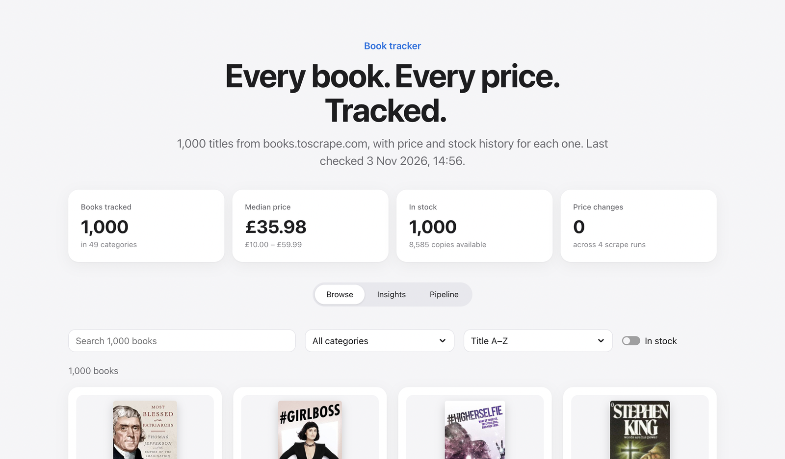
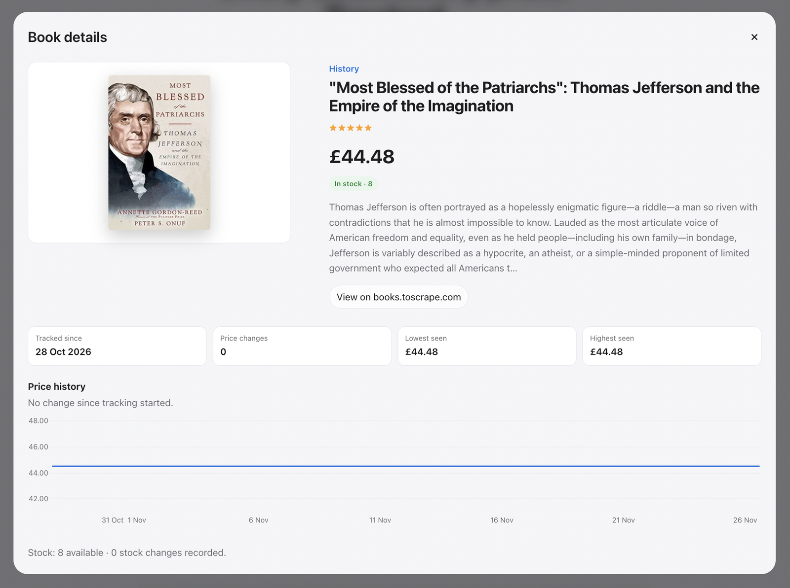
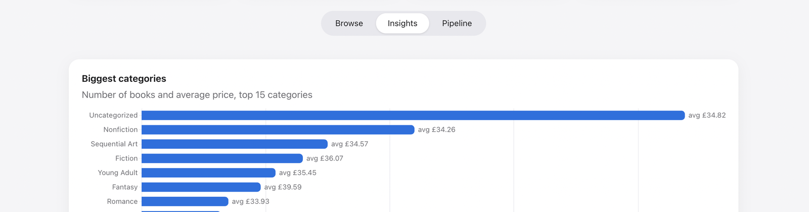
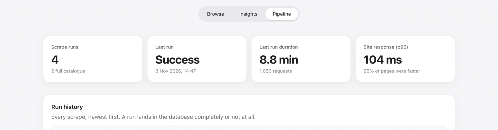

# Book tracker

Scrapes the prices and stock of all 1,000 books on [books.toscrape.com](https://books.toscrape.com), a website without an API, keeps their full history in a Supabase (Postgres) database, and shows everything in a Streamlit app.

```
books.toscrape.com ──scrape──▶ JSON file ──load──▶ Supabase (Postgres) ──read-only──▶ Streamlit app
                     scraper/books_scraper.py      scraper/loader.py + apply_run()     frontend/app.py
```


*Browse: search, filter and sort 1,000 books*

## Purpose

This is my individual project on getting data from a website that offers no API. It has three parts:

1. **A scraper** that collects every book's title, category, price, stock, rating and description.
2. **A database** designed to keep history: when a price or stock level changes, the old value is kept, not overwritten.
3. **An app** to browse the books, see each book's history, and check how the scraper runs went.

## Data collection

- **Source:** [books.toscrape.com](https://books.toscrape.com), a sandbox site made for scraping practice (1,000 fictional book listings on 50 pages). No personal data is collected.
- **How:** `scraper/books_scraper.py` downloads the 50 listing pages, then each book's detail page (exact stock, UPC, description), and parses the HTML with BeautifulSoup. The result is one JSON file per run.
- **Being polite:** by default it waits 0.5 s between requests (shared across 4 parallel workers), identifies itself with a User-Agent (`BookTrackerBot/… (student project)`), retries timeouts and server errors with growing waits, and never retries a 404.
- **Measured:** every run records how many requests failed and how fast the site answered (median, 95th percentile, slowest), so "does the site cope?" is answered with data.
- **Loading:** `scraper/loader.py` sends a JSON file to the database in one transaction, so a run is saved completely or not at all. Loading the same file twice does nothing.

More options (test runs on 5 books or 3 pages, stress test): see [scraper/README.md](scraper/README.md).

## Data persistence

Everything lives in one Supabase Postgres database. The schema is in [`supabase/migrations/`](supabase/migrations/).

| Table | What it holds |
|---|---|
| `books`, `categories`, `sources` | The catalogue. Each book is matched on the site's UPC (`external_id`); our own `id` is the primary key. |
| `price_history`, `stock_history` | A new row only when a value changes (`valid_from` / `valid_to`; the current value has `valid_to = null`). |
| `scrape_runs`, `scrape_errors` | Every run and every failed request, with response-time statistics. |
| `staging_observations` | The raw rows of each run, merged into the tables above by the database function `apply_run()`. The scrape workflow deletes rows older than 30 days. |
| `books_current` (view) | Each book with its current price and stock, for the app. |

Other places data is kept:

- **JSON files** from each run in `scraper/output/` on the computer that ran the scraper (git-ignored).
- **GitHub Actions** keeps the JSON file of a workflow run as a download for 30 days.

**Who can do what:** the app uses Supabase's *publishable key*, which is public by design and is built into `frontend/data.py`. Database rules (row-level security plus grants) only let that key **read** the catalogue, history and run tables. It cannot see the error and staging tables or write anything. Only the loader, which uses the database password from `.env` or a GitHub secret, can write.

## User interaction

There are two ways to use the project.

**Browse the data (the app).** Open the Streamlit app; it has three tabs:

| Tab | Shows |
|---|---|
| Browse | Search, category filter, sort, "in stock" toggle; book cards with a detail view (price history chart, stock, description). |
| Insights | Biggest categories with average price, rating distribution, price bands. |
| Pipeline | Every scrape run: status, books seen, new books, price/stock changes, errors, site response time. |

**Collect new data (the pipeline).** Run the scraper from the command line (`python books_scraper.py --load`), or start the *Daily scrape* workflow by hand in the GitHub Actions tab. The new run then appears in the app's Pipeline tab.

<details>
<summary>More screenshots</summary>


*Book details with price history*


*Insights: categories, ratings and price bands*


*Pipeline: every scrape run with changes and site response time*

</details>

## Setup

Requirements: Python 3.11 or newer. The scraper and the app each have their own virtual environment.

```bash
git clone https://github.com/YannikNMody/book-tracker.git
cd book-tracker
```

### Option A: just look at the data (no account, no keys)

```bash
cd frontend
python3 -m venv .venv
source .venv/bin/activate        # Windows: .venv\Scripts\activate
pip install -r requirements.txt
streamlit run app.py
```

The app opens at http://localhost:8501 and reads the existing data from my Supabase project over HTTPS. Run it from inside `frontend/` so the theme in `.streamlit/config.toml` is used.

<!-- TODO: final wording depends on the professor's answer about Supabase pausing. -->
**If the app shows a connection error:** the database runs on Supabase's free plan, which pauses projects after about a week of low activity. The screenshots show what the app looks like with data.

### Option B: run the whole pipeline with your own database

1. Create a free project at [supabase.com](https://supabase.com).
2. Apply both files in `supabase/migrations/`, in filename order (Supabase dashboard → SQL editor, or `supabase db push` with the Supabase CLI).
3. Copy `.env.example` to `.env` in the repo root and fill in `DATABASE_URL`. The file explains where to find it.
4. Install the scraper and run a small test, then the full catalogue:

   ```bash
   cd scraper
   python3 -m venv .venv
   source .venv/bin/activate
   pip install -r requirements.txt
   python books_scraper.py --limit 5 --load    # 5 books
   python books_scraper.py --load              # all 1,000 books, about 9 minutes
   ```

5. Point the app at your project with the environment variables `SUPABASE_URL` and `SUPABASE_PUBLISHABLE_KEY` (Supabase dashboard → Project Settings → API Keys), then start it as in option A.

Some networks, such as university Wi-Fi, block direct database connections (port 5432). That only affects loading; the app and GitHub Actions are not affected. To run the scraper on GitHub instead, add `DATABASE_URL` as a repository secret and start the *Daily scrape* workflow.

### Tests

Each part has its own tests; run them inside that part's virtual environment:

```bash
cd scraper && python -m pytest -q     # scraper + loader
cd frontend && python -m pytest -q    # app (from the repo root again)
```

- Scraper and app tests need no internet: a local server imitates the website, and the app runs against fake data.
- Loader tests need a **disposable** Postgres database, because they wipe it. They are skipped unless `TEST_DATABASE_URL` is set, and they refuse to run against a Supabase host. GitHub Actions runs them against a throwaway database on every push.

Tested with Python 3.12 (GitHub Actions) and requests 2.34.2, beautifulsoup4 4.15.0, lxml 6.1.3, psycopg 3.3.9, python-dotenv 1.2.4, Streamlit 1.67.0, pandas 3.1.1, Altair 6.3.0 and pytest 9.2.0.

## Learning

**Designing the schema first**

- My professor talked about the "schema" (I first wrote it down as "skimer"): which tables exist, their columns and how they link. I learned to design it before finishing the scraper, because the schema decides what the scraper has to collect. Tracking stock over time, for example, means visiting every book's detail page.
- I asked whether to use the site's UPC or our own ID. The answer is both: our own `id` is the primary key, and the UPC is stored as `external_id` and only used to recognise a book again. If the site changed its IDs, only the matching would change, not every link between tables.
- The history tables only get a new row when a value changes (`valid_from` / `valid_to`), so every row means something. Because the sandbox site never changes, this logic is proven by tests that simulate price changes.
- My question "will the site crash?" became something the database measures: every run stores response times and every failed request is logged.

**Challenge: a password in an error message**

- My database password contained characters like `/`, `$` and `,`, which broke the connection URL, and the error message printed part of the password in the terminal.
- I treated the password as leaked and reset it. The loader now encodes special characters itself and removes secrets from every message it prints.
- Lesson: error messages can leak secrets, and a secret that has been shown once counts as compromised.
- Right after, the connection timed out on university Wi-Fi, which blocks the database port. A timeout points to the network; a wrong password gives "authentication failed".

## Limitations and assistance

**Limitations**

- **The site never changes.** books.toscrape.com is static, so real runs show 0 price and stock changes. The history logic is covered by tests that simulate changes.
- **The data is a snapshot.** It comes from four runs: three test and full runs on 28 Oct 2026 and one full run on 3 Nov 2026. The daily schedule is prepared in `.github/workflows/scrape.yml` but switched off, because a static site would only produce identical snapshots.
- **The app depends on my Supabase project.** If it is paused or deleted, option A shows an error; option B still works.
- **Two placeholder categories.** The site's "Default" and "Add a comment" categories are shown as "Uncategorized"; the database keeps the original names.
- **Run numbers start at 4.** A test load used up numbers 1–3 before it was rolled back; that is normal database behaviour.
- **Not hosted.** The app runs locally.

**AI assistance**

All code in this project was written by AI. I used Claude chat (Opus 5.5) to brainstorm, plan the features and design, and write implementation prompts and guidelines; for this project the chat also wrote much of the code directly. Claude Code (Sonnet 5) implemented, ran, tested and committed the changes in my repository. My part was deciding what to build, making the calls when trade-offs came up, testing the results by hand, and reviewing what went into the repo. Commits made by Claude during submission prep are authored as "Claude". The README text, including the Learning section, was drafted by Claude from my project chats and notes; I reviewed and approved it.

**Other sources**

- Data: [books.toscrape.com](https://books.toscrape.com), a public sandbox for scraping practice. Book covers are not stored; the app links to them on that site.
- Services and libraries: Supabase, GitHub Actions, requests, BeautifulSoup, lxml, psycopg, python-dotenv, Streamlit, pandas, Altair, pytest.
- No tutorials or external code were copied in.

## Technical details

| Folder | What it is |
|---|---|
| `scraper/` | Scraper, loader and tests. Options, output format and how loading works: [scraper/README.md](scraper/README.md). |
| `frontend/` | Streamlit app, read-only data access and tests: [frontend/README.md](frontend/README.md). |
| `supabase/migrations/` | Database schema and the `apply_run()` merge function, applied in filename order. |
| `.github/workflows/` | `scrape.yml` runs the scraper and loader (manual start; schedule prepared, switched off); `tests.yml` runs all tests on every push. |
| `docs/screenshots/` | Screenshots used in this README. |

Design decisions worth knowing:

- **History only on change.** Price and stock rows are added only when a value differs from the current one, so the history stays small and every row means something.
- **All-or-nothing loads.** One transaction per run; a failed load leaves the database unchanged and the JSON file can be loaded again later.
- **Circuit breaker.** Only a complete, error-free full run may mark books as no longer listed, and only if it saw at least half the catalogue, so a broken page layout cannot wipe the data.
- **Money as exact numbers.** Prices are stored as `numeric` and passed around as strings, never as floating-point numbers.

## Audit

Before publishing, the repository was checked for secrets, personal data, unnecessary files and documentation gaps with an AI-assisted audit. See [AUDIT.md](AUDIT.md).

## License

No license: coursework, published for grading. All rights reserved.
